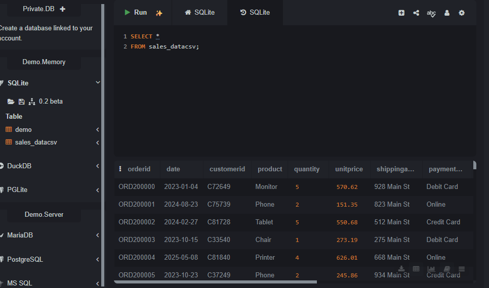
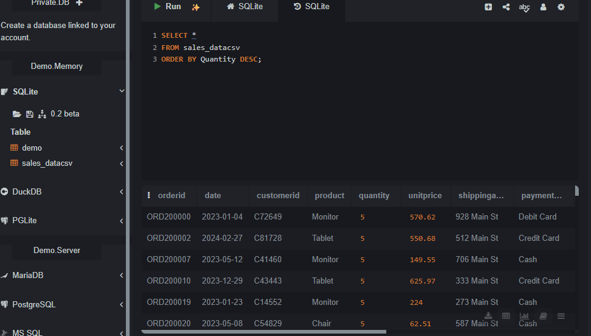
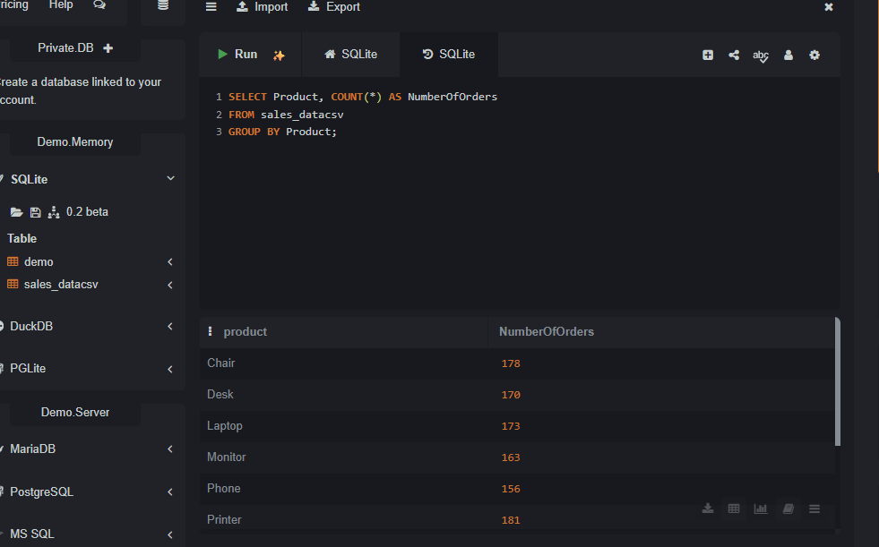
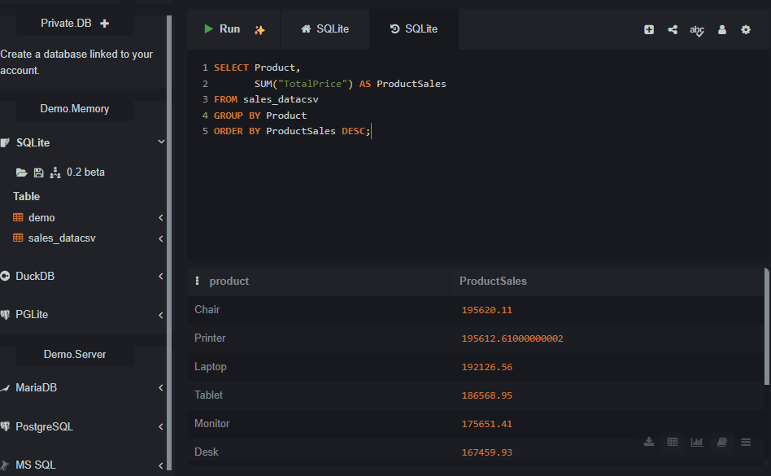
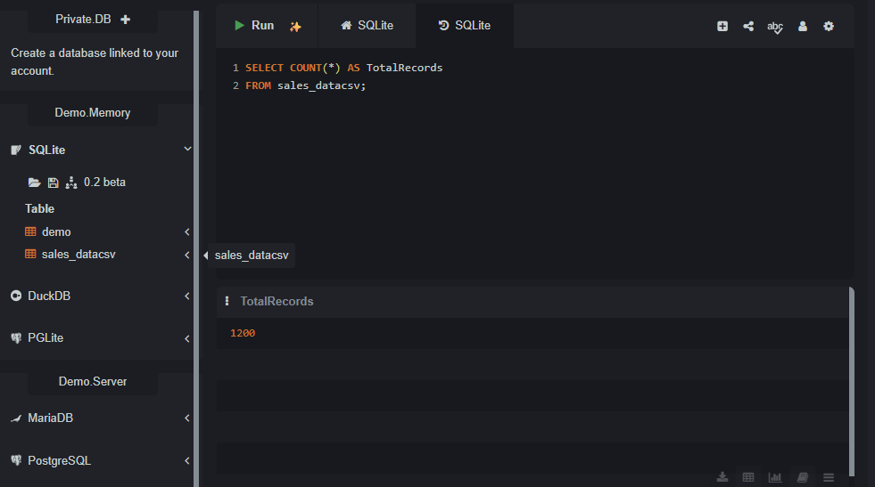

# DecodeLabs Project 3: SQL Data Analysis Using SQLite

## Project Overview
This project involved using SQL to explore and analyse a sales dataset. The exercises focused on retrieving records, filtering data, sorting results, counting records, calculating summary statistics, and comparing sales across products.

## Tools Used
- SQLite
- SQL

## Analysis Performed
The project covered the following exercises:

1. **Data selection:** Retrieved records from the sales dataset.
2. **Filtering data:** Selected specific columns and filtered records by product.
3. **Sorting data:** Arranged records by quantity in descending order.
4. **Grouping and counting:** Counted records for each product.
5. **Record counting:** Calculated the total number of records.
6. **Total quantity:** Calculated the sum of quantities.
7. **Average quantity:** Calculated the average quantity.
8. **Product sales analysis:** Summed total prices for each product and ranked products from highest to lowest sales.

## Project Files
- **SQL analysis file:** Contains the SQL queries used for the exercises.
- **Word report:** Documents the Project 3 SQL data analysis work.
  
## Project Screenshots

The screenshots below show selected SQL queries and their results from the analysis.

### 1. Sales Data Query

### 2. Order by Quantity

### 3. Product Count

### 4. Total Sales by Product

### 5. Total Records

## SQL Demonstration Video

Watch the video demonstration of my SQL queries and analysis results.

[▶ Watch the SQL Project Demonstration](https://drive.google.com/file/d/1dW23-5Lnw7f7RbjKKwsau_7rYBMPSepx/view?usp=sharing)

## Learning Outcomes
This project provided practical experience in writing SQL queries, retrieving and filtering data, organising query results, and using aggregate functions to summarise sales information.

## Conclusion
The project demonstrated how SQL can be used to explore sales data and generate useful summaries to support data analysis.
